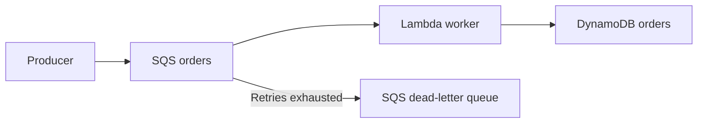

# AWS SQS Order Pipeline

An event-driven order worker with at-least-once delivery, idempotent writes, partial batch retries and a dead-letter queue. It accepts synthetic orders with an ID and an amount in cents.



The DynamoDB conditional write prevents parallel consumers from inserting the same order twice. An identical duplicate succeeds. An existing order with a different amount is retried and eventually moved to the DLQ. Returning only failed SQS message IDs avoids retrying successful records from the same batch. The alarm reports visible DLQ messages in CloudWatch. This lab has no notification destination configured.

## Verify locally

```sh
python -m unittest discover -s tests -v
terraform init -backend=false
terraform fmt -check
terraform validate
```

The unit tests use an in-memory fake DynamoDB table. Terraform validation downloads providers and does not need AWS credentials.

## Optional AWS demo

Configure AWS credentials for a sandbox account. Set the AWS CLI region to the same region as Terraform. Deployment can incur AWS charges.

```sh
export AWS_DEFAULT_REGION=eu-west-3
terraform plan -out=demo.tfplan
terraform apply demo.tfplan
QUEUE_URL="$(terraform output -raw queue_url)"
for i in 1 2; do
  aws sqs send-message --queue-url "$QUEUE_URL" \
    --message-body '{"order_id":"demo-001","amount_cents":1299}'
done
aws sqs send-message --queue-url "$QUEUE_URL" --message-body '{"order_id":"bad"}'
```

After Lambda consumes the two valid messages, verify the single stored record. The invalid message reaches the DLQ after repeated delivery attempts. The configured visibility timeout is 90 seconds, so this takes several minutes.

```sh
aws dynamodb get-item --table-name "$(terraform output -raw table_name)" \
  --key '{"order_id":{"S":"demo-001"}}' --consistent-read
aws sqs get-queue-attributes --queue-url "$(terraform output -raw dlq_url)" \
  --attribute-names ApproximateNumberOfMessages
```

Run `terraform destroy` when finished with the demo. CI validates Terraform and runs Python tests without creating AWS resources.
